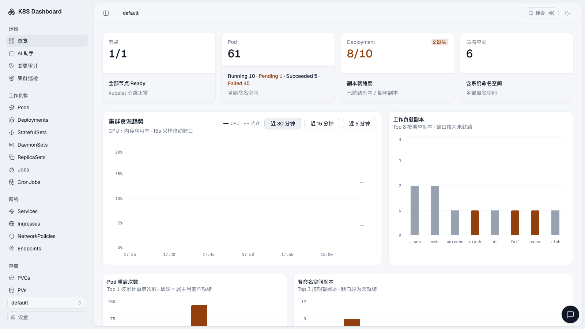
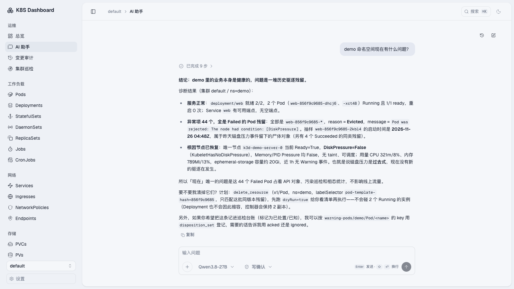
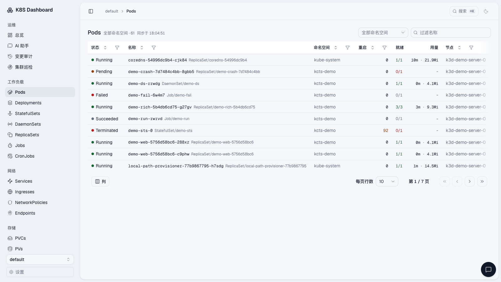
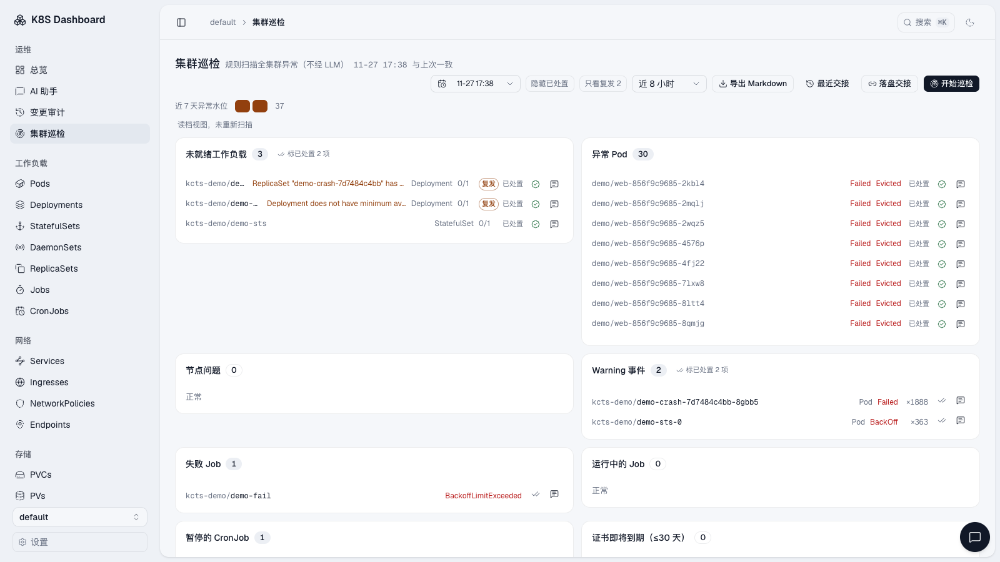
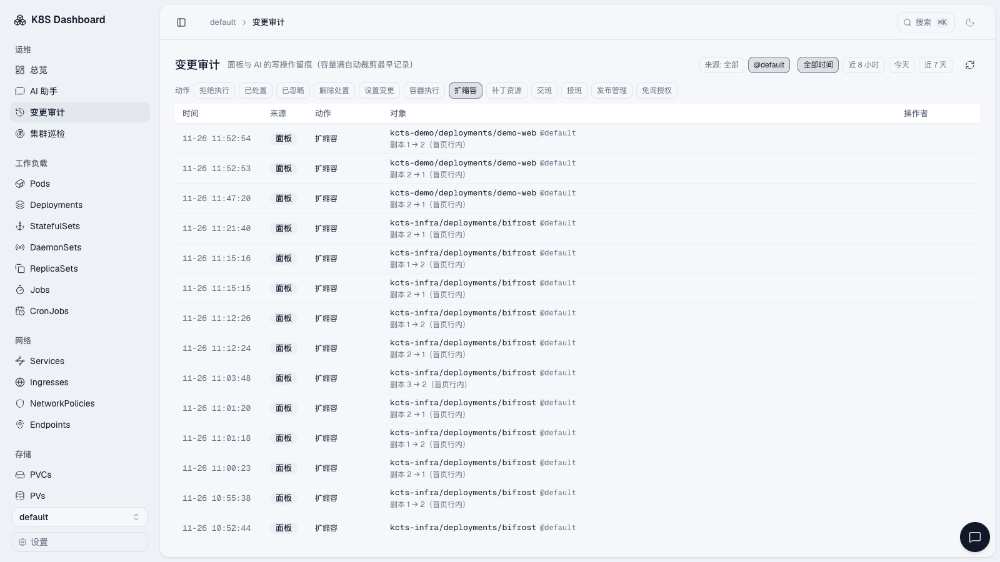
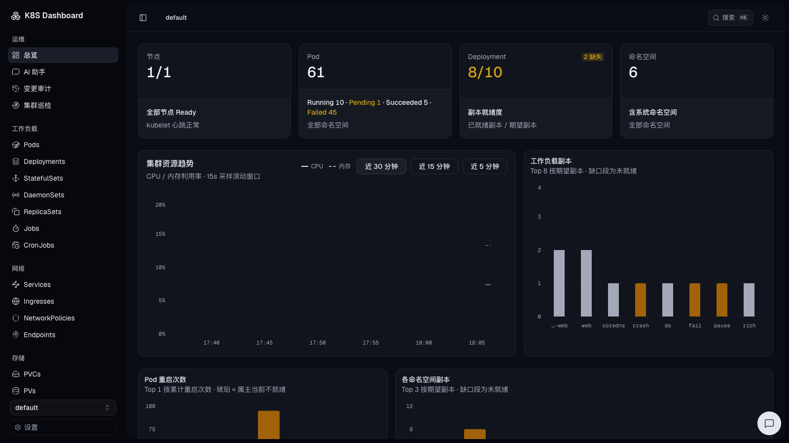

# K8S Dashboard

带 AI 助手优先体验的 Kubernetes 看板。基于 [Headlamp](https://github.com/kubernetes-sigs/headlamp)
fork（Apache-2.0）：前端重写为 Vite + React 19 + Tailwind + shadcn/ui（中文优先、深浅主题），
新增 Node 版 AI 执行层（`ai-exec/`），保留 Headlamp Go 后端做多集群/RBAC 代理。

> 本项目是独立 fork，与 CNCF / kubernetes-sigs 官方 Headlamp 无隶属关系；
> 上游 LICENSE 与 NOTICE 原样保留。

## 特性

- **AI 助手**：流式对话，自动携带当前页面资源上下文；k8s 工具（查询/日志/巡检/写操作）
  全部服务端执行，写类工具一律二次审批并落审计流水
- **集群巡检**：一键扫描全集群异常（镜像拉取失败/ CrashLoop / 副本不足 / 事件风暴…），
  可生成值班交接单
- **变更审计**：AI 操作与手动写操作统一流水，含操作者与耗时
- **资源管理**：列表实时 watch + CPU/内存用量列、YAML 就地编辑、HPA 向导、
  CronJob 操作、节点 shell / 文件传输、Secret 解码
- **Helm**：应用管理 + 一键升级回滚（后端 `--enable-helm`）
- **全局 ⌘K 搜索**（支持标签语法 `app=web` 直达过滤结果）、资源拓扑图、多集群（含动态集群接入）

## 界面

总览：集群健康、副本就绪度与 15s 采样的 CPU/内存趋势（深浅双主题）：



AI 助手自动携带当前页面上下文，工具调用逐步可查、写操作先出执行计划再审批；
列表页实时 watch，自带 CPU/内存用量列：

| AI 助手 | Pods 列表 |
| --- | --- |
|  |  |

集群巡检按规则扫描全集群异常并支持处置/复发跟踪；变更审计统一记录面板与 AI 的每次写操作：

| 集群巡检 | 变更审计 |
| --- | --- |
|  |  |

深色主题：



## 快速开始

```bash
docker build -t k8s-dashboard .
docker run -d --name k8s-dashboard -p 4467:4467 \
  -e LLM_GATEWAY_BASE=https://your-openai-compatible-gateway/v1 \
  -e LLM_API_KEY=your-key \
  -e LLM_MODEL=your-model \
  -v k8s-dash-data:/data/ai \
  -v ~/.kube/config:/home/headlamp/.kube/config:ro \
  k8s-dashboard
# 打开 http://localhost:4467
```

`LLM_*` 三项可由 env 注入（`docker run -e` / k8s env）作为底座，也可在「设置 → AI 服务」
直接填写网关/模型/密钥——保存即生效并持久化到 `/data/ai` 卷，密钥只写不回显、不下发浏览器；
不配置也可完整使用看板，仅 AI 助手/巡检提示「AI 未配置」。巡检间隔、告警 webhook
等运行期配置同样在设置页修改。

## 开发

```bash
cd web && npm ci && npm run dev      # 前端（代理到后端，K8S_PROXY_TARGET 可覆盖，默认 127.0.0.1:4467）
cd backend && go build -o headlamp-server ./cmd
cd ai-exec && npm ci && node server.js   # AI 执行层（env: LLM_GATEWAY_BASE / LLM_API_KEY / LLM_MODEL / PI_DATA_DIR / K8S_BACKEND_BASE）
```

检查命令：

```bash
cd web && npx tsc --noEmit && npx vitest run && npm run build
cd ai-exec && node --test lib/*.test.js
./qa/demo-fixture.sh up              # demo 命名空间夹具（本地/测试集群专用）
```

## 安全模型

- 所有 k8s API 经 headlamp-server 按 kubeconfig / in-cluster 凭据的 RBAC 转发，UI 按权限呈现
- AI 写类工具（scale/restart/delete…）强制二次审批；审计与交接数据存服务端卷
- LLM 网关凭据只存在于服务端环境变量与持久卷，永不下发浏览器
- 漏洞报告见 [SECURITY.md](SECURITY.md)

## 许可

Apache-2.0。基于 Headlamp（Copyright The Headlamp Authors）fork，
上游 [LICENSE](LICENSE) 与 [NOTICE](NOTICE) 保留；本仓库增量同样以 Apache-2.0 发布。
